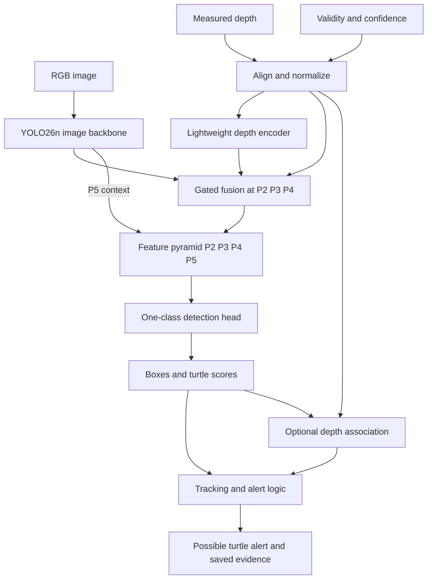

# Codex implementation instructions: multimodal turtle detector

## Objective

Build a reproducible turtle-detection system for land-based construction-site surveys. Detect any turtle, including small, stationary, withdrawn, and partly obscured animals. Present detections for human inspection and safe site procedures.

Target platforms:

- Luxonis OAK-D Pro: RGB, monochrome/near-infrared imagery, and stereo depth.
- iPhone: rear RGB camera and optional LiDAR depth on supported devices.

The user has an untextured white 3D shell scan without scutes. Use it to create supplementary synthetic training data by applying realistic shell textures, potentially derived from appropriately licensed iNaturalist photographs. The scan is a training asset, not an input required during detection.

Implement the architecture below incrementally. It is a proposed design, not a trained or benchmarked model. Do not claim accuracy, detection range, real-time performance, or device compatibility without measurements.

## Working instructions

1. Inspect the repository and applicable instructions before editing. Reuse suitable existing infrastructure.
2. Identify available training data, scan files, camera recordings, hardware, and compute resources. Do not assume these exist.
3. Confirm software capabilities from official documentation and source code, then pin compatible versions. Record versions, checkpoints, configuration, and dataset manifests with each experiment.
4. Implement and validate a small end-to-end baseline before adding fusion complexity.
5. Continue independent implementation when data or hardware is unavailable. Clearly distinguish synthetic fixture tests, simulated inputs, and real-device verification.
6. Do not download large datasets, start paid training, publish an app, or initiate external uploads unless authorized. Prepare local code and reviewable configurations first.
7. Do not fabricate training results or hide unsupported export operations. Report blockers and concrete fallback options.

Resolve these deployment parameters with the user when they become necessary: geographic region and likely species, minimum turtle size, required detection distance, camera mounting and motion, iPhone model, available companion computer, and acceptable alert delay and false-alert rate. Keep them configurable until confirmed.

## Architecture decision

Use a YOLO26n detection backbone with:

- A separate lightweight encoder for measured depth, validity, and confidence.
- Confidence-gated residual feature fusion at strides 4, 8, and 16.
- An additional P2 detection level for small objects.
- A one-class detector with the class `turtle`.
- Separate postprocessing for tracking, optional distance estimation, and alerts.

Start from detection-pretrained weights. Compare depth-pretrained initialization only in a later controlled experiment. A monocular-depth model consumes RGB and predicts depth; it is not automatically a measured-depth encoder or a better detector.

Use 2D aligned depth maps rather than BEV, voxelization, PointPillars, or a large point-cloud transformer in version one. Do not implement cross-attention until simpler fusion demonstrates a need for it.



## Input and preprocessing contract

Initial model input resolution: 640 × 640. Preserve aspect ratio with a documented resize-and-pad transform. This resolution is a starting point; determine final resolution from real small-target performance and device latency.

Use two float tensors in training:

- `image`: `[B, 3, H, W]`, RGB normalized consistently with the pretrained backbone.
- `geometry`: `[B, 3, H, W]`, containing normalized metric depth, binary validity, and normalized confidence.

Deployment adapters may change layout or dtype, but must preserve numerical semantics.

Depth processing requirements:

- Standardize on camera-axis depth in meters. Do not confuse radial range, disparity, and camera-axis depth.
- Use sensor intrinsics, extrinsics, distortion handling, and timestamps to align measurements to the selected image frame.
- For 3D reprojection, transform into the target camera frame, divide projected coordinates by positive target-camera Z, and resolve overlapping samples with visibility-aware depth selection.
- Account for camera orientation, image resizing, padding, and crops. Preserve the inverse transform for displaying detections.
- Reject or mark stale, invalid, nonfinite, and unusable measurements. Synchronization tolerances must be configurable.
- Preserve invalid regions and discontinuities during resampling. Do not interpolate foreground and background into false surfaces.
- Use a fixed configurable depth normalization, such as clipped log-depth, across training and inference. Do not normalize each frame by its own depth extrema.
- Set invalid normalized depth to zero and validity to zero. Zero is a placeholder, not a measured zero distance.
- Normalize confidence through device-specific adapters. Inspect the actual confidence convention of the selected OAK API; do not assume that larger raw values always mean better quality.
- If confidence is unavailable, document the fallback quality policy rather than presenting a fabricated calibrated probability.
- Mark padded pixels invalid.

Missing depth means **unknown**, never background. Upsampling does not add measured detail. Do not use completed or monocular-predicted depth as if it were an independent sensor measurement.

For RGB-only samples or unsupported iPhones, provide zero geometry, zero validity, and zero confidence.

## Model specification

### Image branch

Initialize the image backbone from a pinned YOLO26n detection checkpoint. Expose features at strides 4, 8, 16, and 32. Determine channel counts from the pinned implementation rather than assuming a particular release layout.

### Depth branch

Use a small stride-2 convolutional stem followed by depthwise-separable downsampling and refinement blocks. Proposed feature widths:

| Level | Stride | Size at 640 input | Depth channels |
|---|---:|---:|---:|
| Stem | 2 | 320 × 320 | 8 |
| P2 | 4 | 160 × 160 | 16 |
| P3 | 8 | 80 × 80 | 32 |
| P4 | 16 | 40 × 40 | 64 |

These widths are design parameters, not claimed optimal values. Use standard exportable operations. Avoid sparse convolution dependencies and custom deployment kernels in version one.

### Gated residual fusion

For each level `s` in P2, P3, and P4:

```text
I_s = image features
D_s = depth-encoder features
Q_s = spatially downsampled valid-depth confidence
P_s = Conv1x1(D_s), projected to the image feature channel count
G_s = sigmoid(SmallConv(concat(I_s, D_s, Q_s)))
F_s = I_s + Q_s * G_s * P_s
```

Define confidence downsampling explicitly and retain the fraction of valid support. Do not allow one valid point to imply that an entire large feature cell has dense reliable depth.

Initialize the final projection producing `P_s` to zero. With no valid depth, force `Q_s = 0`, so fusion returns the image features exactly. Test this numerical property, including nonzero learned biases in the depth branch.

The zero-depth path is not a guarantee that a jointly trained model matches the accuracy of an independently trained RGB baseline. Measure both.

### Neck and detection head

Extend the feature pyramid with top-down and bottom-up paths to produce P2, P3, P4, and P5. Use fused P2–P4 features and image P5 context.

Attach a one-class anchor-free YOLO26 detection head to all four scales. Retain the pinned implementation's classification, box regression, assignment, and applicable training-head machinery. Adapt the loss and stride metadata to the extra level.

Do not add anchor k-means or auto-anchor tuning: YOLO26 is anchor-free.

Choose and document one inference path explicitly. The one-to-many path with NMS is an acceptable baseline. Evaluate the one-to-one export path separately if it improves deployment. Validate output decoding for the custom four-scale head; do not assume a stock parser supports it.

Do not add a jointly trained depth-output head or segmentation head in version one. These are later ablations requiring explicit implementation and supervision.

## RGB and infrared variants

Train a common RGB-depth model using both OAK and iPhone data, with balanced sampling and sensor-specific preprocessing.

For OAK low-light use, fine-tune a separate monochrome/IR variant of the same architecture. Repeating a monochrome frame across three image channels is an acceptable initial input adapter. Train and validate with actual IR recordings; grayscale conversion alone is not infrared simulation.

Align stereo depth to the monochrome camera for that variant. Keep each detector's coordinate system explicit.

If RGB and IR models run together, associate detections through calibrated geometry and merge duplicates. Retain credible unmatched detections; do not require agreement between sensors. Benchmark whether simultaneous inference fits the device budget before adopting it.

OAK near-IR is not thermal imaging and does not provide visibility through opaque vegetation. iPhone LiDAR is a geometry input, not a substitute for illuminated RGB detection at night.

## Training data and synthetic shell pipeline

Each real paired sample should retain:

- Image, metric depth, validity, and available confidence.
- Turtle boxes, with a consistent policy for partially visible animals.
- Sensor type, timestamps, calibration, resolution, orientation, and preprocessing metadata.
- Site, session, observation, and individual identifiers when known.
- Lighting, distance, approximate target size, and occlusion annotations when available.
- Source and license metadata for third-party assets.

Use real turtle photographs and real site recordings as the foundation. Include no-turtle scenes and hard negatives such as rocks, leaf piles, curved debris, shadows, and equipment parts. Stationary turtles must be represented.

Synthetic generation steps:

1. Inspect the scan's units, orientation, topology, and actual shell geometry.
2. If scute removal changed the visible surface, repair geometry where needed; texture alone cannot restore missing shape.
3. Create UV coordinates and apply appropriately licensed shell textures. Prefer well-aligned photographs; repair stretched or unseen regions and reduce baked-in lighting artifacts.
4. Use biologically plausible texture/shape combinations and multiple shapes when available. Do not claim one shell with many textures represents full species variation.
5. Render varied construction-site scenes, including soil, gravel, foliage, debris, partial cover, lighting, blur, dirt, wetness, viewpoints, and target sizes.
6. Export aligned RGB, camera-axis depth, object labels, calibration, and masks where useful.
7. Apply separate OAK-like and iPhone-like depth degradation: limited spatial detail, missing measurements, noise, boundary errors, and occasional misalignment.
8. Do not label entirely invisible turtles as visually detectable positives under an ordinary visible-object detection policy. Document the occlusion policy.

Check each iNaturalist photo's license independently from the observation-data license. Prefer CC0, suitable CC BY assets with attribution, or direct permission for intended reuse. Preserve source URL, creator, license, and modifications. Do not assume default noncommercial images permit construction-product use.

Keep all derivatives of a source photo, scan, observation, or capture sequence in the same dataset partition. Reserve real sites or sessions for evaluation. Synthetic test scores are not field validation.

## Training plan

1. Train and evaluate stock RGB-only YOLO26n.
2. Add P2 and evaluate RGB-only performance and compute cost.
3. Add depth preprocessing, the encoder, and gated fusion. Initialize compatible weights from the RGB baseline.
4. Train with complete depth dropout, local holes, sensor noise, and controlled alignment perturbations. Make augmentation probabilities configurable; select them from validation evidence.
5. Fine-tune on paired real recordings from both target devices.
6. Train the OAK monochrome/IR variant using actual mono/IR data.
7. Optimize and export only after checking the intended hardware path on a minimally trained graph.

Use the pinned implementation's supported optimizer and loss recipe as the starting point. Verify STAL and Progressive Loss behavior in that version. Do not blindly copy learning rates, optimizer names, or loss weights from the supplied summary.

Apply spatial transformations consistently to images, depth, masks, confidence, and labels. Update camera metadata where required. Use appearance augmentation on image channels only. Avoid ordinary RGB mixup on metric-depth pairs unless its geometry semantics are explicitly defined. Disable complex multimodal mosaic initially.

Use hard-negative mining and balanced encounter sampling. A single foreground class still has substantial foreground/background imbalance.

## Tracking, distance, and alerts

The network produces 2D detections; it does not automatically produce calibrated probabilities or accurate 3D boxes.

Application records should include:

```text
bounding_box_original_image
turtle_score
track_id
distance_meters: optional
distance_quality: unknown | low | usable
timestamp
sensor_mode
evidence_image_reference
```

Estimate distance separately from valid depth associated with each detection. Avoid averaging the entire bounding box. Use a documented robust interior-region policy, report uncertainty, and return unknown when foreground/background association is ambiguous. A later segmentation model can improve this association.

Use tracking to reduce duplicate alerts and preserve evidence. Motion must not be a detection requirement. Any multi-frame confirmation rule must be evaluated for added latency and lost brief sightings.

Select score thresholds against encounter recall and false alerts per hour. Do not raise thresholds solely to make demonstrations look cleaner. Missing depth must not automatically veto an image detection.

The interface should show possible-turtle alerts, optional distance, captured evidence, and user feedback such as confirmed turtle or false alert. Do not present no detection as site clearance or implement automatic machinery control under this brief.

## Deployment

### iPhone

- Build a native Swift application with camera display and on-device inference.
- On supported devices, use ARKit frame imagery, scene depth, and confidence. Check capabilities at runtime.
- On unsupported devices or missing frames, use the trained image-only fallback through zero geometry.
- Export the custom multi-input graph with Core ML tooling and supply its inputs explicitly. Do not assume a standard Vision image-only wrapper can populate auxiliary tensors.
- Preserve orientation, calibration, resize, and display-coordinate transforms.
- Benchmark on the actual target phone, including sustained thermal behavior and complete capture-to-alert delay.

### OAK-D Pro

- Use DepthAI for acquisition, stereo depth, timestamps, calibration, and IR control.
- Attempt ONNX-to-RVC2 compilation of the custom graph early.
- Check multi-input support, operations, memory, preprocessing, numerical parity, and four-scale output decoding.
- Measure actual full-pipeline latency and throughput. Desktop GPU timings do not establish OAK performance.
- If full fusion does not meet constraints, offer a supported RGB or mono detector on-camera with depth association on the host, or run full fusion on an authorized companion computer.
- Clearly label a simplified fallback as a different model configuration; do not claim it provides learned depth fusion.

Standard YOLO26 export support does not guarantee support for custom fusion blocks or a P2 head. Keep conversion logs and resolve failures explicitly.

## Experiments and acceptance criteria

Compare on the same held-out real captures:

| Experiment | Purpose |
|---|---|
| Stock RGB detector | Establish baseline |
| RGB detector with P2 | Isolate benefit and cost of P2 |
| RGB plus post-hoc depth association | Establish simple depth baseline |
| Gated RGB-depth without P2 | Isolate fusion benefit |
| Gated RGB-depth with P2 | Evaluate proposed architecture |
| Real data versus real plus synthetic | Measure value of shell renders |
| Complete/partial depth dropout | Measure fallback behavior |
| Calibration perturbation | Measure sensitivity to alignment |
| Mono/IR variant | Evaluate actual low-light performance |

Report encounter-level recall, false alerts per hour, time to first alert, precision/recall curves, AP and AP-small, and performance by target pixel size, distance, cover, illumination, site, and device. Define an encounter and alert deduplication policy before scoring. Report sample counts and uncertainty; do not rely on aggregate accuracy alone.

Also report model size, memory use, preprocessing time, inference time, postprocessing time, and end-to-end latency, including tail latency where measurable.

Required meaningful checks:

- Projection, orientation, and resize round trips agree on known synthetic geometry.
- Missing, nonfinite, and padded depth do not produce NaNs or false measured surfaces.
- Zero geometry disables depth fusion numerically.
- Geometric augmentation preserves label and modality correspondence.
- All four detection levels produce correctly decoded boxes.
- Exported outputs agree with reference-model outputs within documented tolerances.
- A no-depth phone session continues detection correctly.
- IR and RGB coordinate association does not silently mix camera frames.
- Tracking does not require turtle movement or automatically discard brief detections.

Do not invent numeric pass thresholds for field safety. Propose thresholds using the intended operating conditions and agree them with the user before calling the system deployment-ready. Retain fusion only if its measured benefit justifies its accuracy, latency, and maintenance costs.

## Expected deliverables

- Reproducible environment and pinned dependencies.
- Dataset schema, source/license manifest, split tooling, and validation tools.
- Sensor adapters and preprocessing with recorded calibration conventions.
- RGB baseline, P2 extension, depth encoder, gated fusion, and training configurations.
- Synthetic shell generation pipeline when the scan and textures are available.
- Evaluation scripts and comparative reports with actual measured results.
- Core ML and RVC2 export attempts, parity checks, and documented limitations.
- OAK demonstration and an iPhone application scaffold, progressing to device-tested inference when hardware is available.
- A concise README with commands, artifact locations, assumptions, and remaining work.

## Corrections to preserve from the source summary

- YOLO26 is anchor-free; remove anchor tuning.
- Task-specific model families do not imply that joint detection-plus-depth training is available without custom work.
- Projecting sparse points does not produce a genuinely dense measured depth map.
- Missing depth is unknown, not background.
- Cross-attention is not proven superior for this turtle dataset.
- Late fusion need not require agreement from both sensors.
- Sensor motion alone does not imply changing intrinsics or relative extrinsics in a rigid sensor assembly; timestamp alignment and actual calibration integrity must be assessed separately.
- High score thresholds trade false alerts for missed turtles.
- Monocular or completed depth must not be presented as independent measured evidence.
- Published desktop benchmark numbers and speculative Jetson timings are not device acceptance results.

## Primary references

Verify against the versions actually used during implementation:

- [Ultralytics YOLO26](https://docs.ultralytics.com/models/yolo26/)
- [YOLO26 model configuration](https://github.com/ultralytics/ultralytics/blob/main/ultralytics/cfg/models/26/yolo26.yaml)
- [Ultralytics architecture overview](https://docs.ultralytics.com/guides/yolo-architecture/)
- [Ultralytics depth estimation](https://docs.ultralytics.com/tasks/depth/)
- [Core ML export](https://docs.ultralytics.com/integrations/coreml/)
- [Luxonis conversion tools and supported models](https://github.com/luxonis/tools)
- [Luxonis model conversion](https://docs.luxonis.com/software-v3/ai-inference/conversion)
- [OAK-D Pro hardware](https://docs.luxonis.com/hardware/products/OAK-D%20Pro)
- [Apple ARDepthData](https://developer.apple.com/documentation/arkit/ardepthdata)
- [BlenderProc](https://github.com/DLR-RM/BlenderProc)
- [Blender UV projection](https://docs.blender.org/manual/en/latest/modeling/modifiers/modify/uv_project.html)
- [iNaturalist media-use guidance](https://help.inaturalist.org/en/support/solutions/articles/151000169918)
